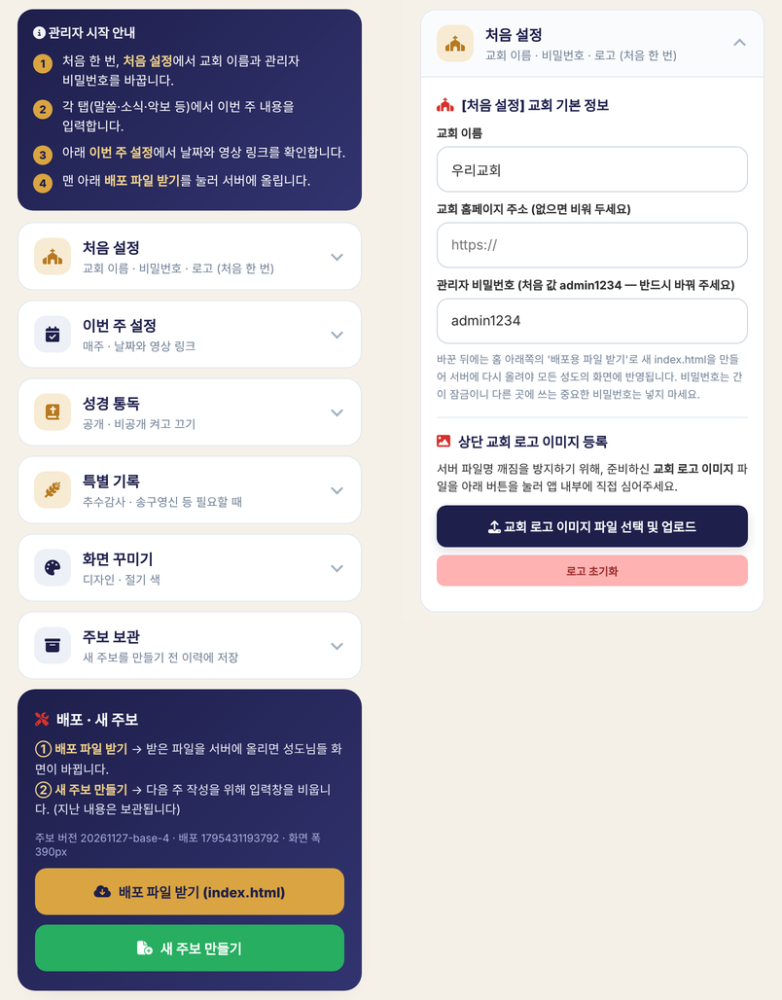
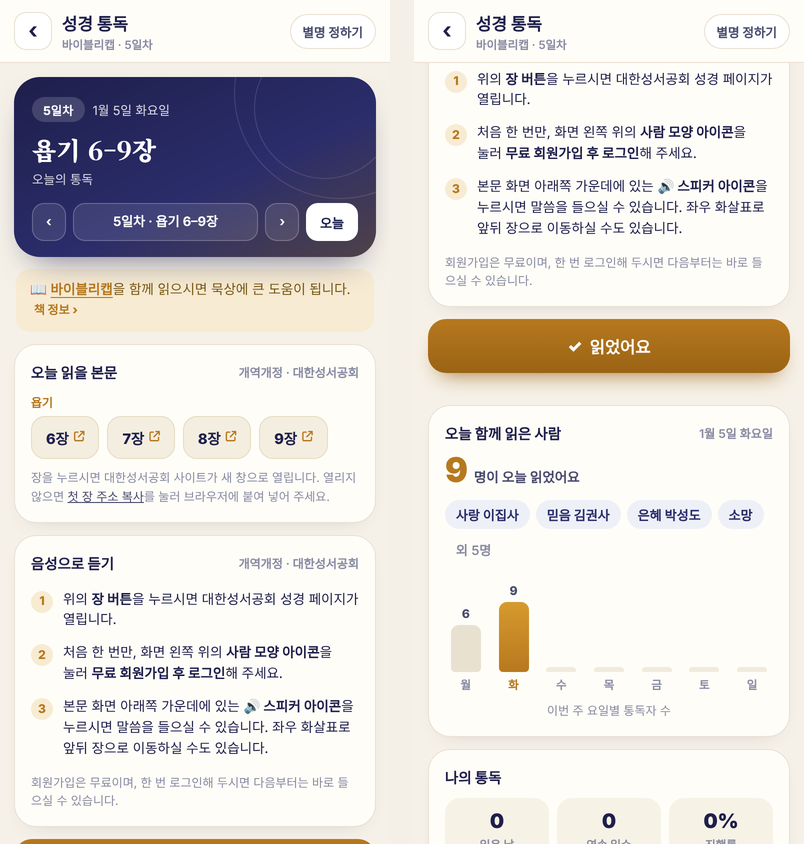

# 스마트 주보 (Smart Jubo) v1.1

교회 주보를 성도의 휴대폰에서 **앱처럼** 보여 주는 무료 웹앱입니다.
서버 비용 없이 **Cloudflare Pages(무료)** 에 파일을 올리기만 하면 `https://프로젝트이름.pages.dev` 주소가 생기고, 그 링크 하나로 모든 성도가 주보를 볼 수 있습니다.
다시본교회에서 실제로 사용하는 주보 앱을 다른 교회도 쓸 수 있도록 기본 버전으로 정리했습니다.


> 위 화면은 다시본교회가 실제로 쓰는 모습입니다. 악보는 저작권 걱정이 없도록 가상의 예시 악보로 바꾸었습니다.

## 이런 일을 할 수 있어요

| 탭 | 내용 |
|---|---|
| 홈 | 이번 주 설교 제목 카드(절기에 따라 색이 바뀜), 예배·기도회·말씀 도시락·쇼츠 영상 링크, 예배 순서, 교회 소식, 예배 안내 |
| 말씀 | 성경 본문, 설교 노트, 나눔 질문 (글자 크기 조절) |
| 악보 | 최근 두 번 예배의 찬양 악보 사진 |
| 소식 | 교회 소식 (번호·가나다 항목 자동 강조) |
| 나의 기록 | 마음으로 드리는 고백, 목장·셀 나눔, 심방·양육 신청, 지난 주보 보기 |
| 특별 기록 | 추수감사·송구영신 등 한 해의 은혜를 적어 제출하는 기능 (필요할 때만 켬) |
| 성경 통독 | 바이블리캡 365일 순서로 함께 읽고, 오늘 읽은 사람 수·별명·요일별 인원을 보는 기능 (켜고 끌 수 있음, 시작일 설정) |
| 관리자 모드 | 비밀번호를 넣고 목사님·담당자가 주보 내용을 직접 입력하고 수정. v1.1부터 기능별로 접히는 칸으로 정돈 |





- 성도가 제출한 글은 **구글 시트에 자동으로 쌓입니다** (선택 사항, 연결하지 않아도 주보 보기는 모두 됩니다).
- 한 번 열어 본 주보는 오프라인에서도 보이고, 새 주보를 올리면 자동으로 바뀝니다.
- 설치할 프로그램이 없고, 웹 브라우저만 있으면 됩니다.

## 5분 시작하기

1. 이 저장소의 **Releases**에서 `smart-jubo-v1.1.zip`을 내려받아 압축을 풉니다. (또는 `서버에_올릴_파일` 폴더만 받아도 됩니다.)
2. [cloudflare.com](https://www.cloudflare.com)에서 무료 계정을 만듭니다.
3. **Workers & Pages → Create application → Get started → Drag and drop your files** 를 선택합니다.
4. 프로젝트 이름(영문 소문자·숫자·하이픈)을 정하고, `서버에_올릴_파일` 폴더 **안의 파일들**을 끌어다 놓은 뒤 **Deploy site** 를 누릅니다.
5. 나온 주소(`https://프로젝트이름.pages.dev`)를 컴퓨터에서 열고, 오른쪽 위 **관리자 모드**에 처음 비밀번호 `admin1234` 를 입력합니다.
6. 홈 맨 아래 관리자 메뉴의 **처음 설정** 칸을 눌러 교회 이름과 **새 비밀번호**를 입력합니다.
7. 내용을 입력한 뒤 **배포 파일 받기 (index.html)** 를 눌러 새 파일을 받고, 서버에 다시 올립니다.

자세한 그림 설명(구글 시트 연결, 매주 올리는 순서, 특별 기록과 성경 통독 켜기, 문제 해결)은 **[manual.pdf](manual.pdf)** 를 보세요. 컴퓨터를 처음 쓰는 분도 따라 할 수 있게 단계별로 적었습니다.

## 폴더 구성

```
스마트 주보/
├─ 서버에_올릴_파일/            무료 서버에 통째로 올리는 파일들
│   ├─ index.html              주보 본체 (화면·내용·설정이 모두 들어 있음)
│   ├─ sw.js                   빠른 열기·오프라인 보기 (수정하지 않음)
│   ├─ recovery.html           화면이 안 바뀔 때 복구용 (수정하지 않음)
│   ├─ manifest.json           홈 화면에 추가할 때 쓰는 앱 이름
│   ├─ _headers                새 주보가 바로 반영되게 하는 설정 (수정하지 않음)
│   └─ icon-192.png, icon-512.png   앱 아이콘
├─ Code.gs                     구글 시트 연결용 코드 (서버에는 올리지 않음)
├─ manual.pdf                  14쪽 사용 설명서
└─ docs/images/                이 문서에 쓰인 화면 이미지
```

## 알아 두세요

- **처음 비밀번호(`admin1234`)는 반드시 바꾸세요.** 관리자 비밀번호는 `index.html` 안에 그대로 들어 있어서, 성도가 실수로 관리자 모드를 여는 것을 막는 **간이 잠금**일 뿐입니다. 다른 곳에 쓰는 비밀번호를 넣지 마세요.
- 관리자가 입력한 내용은 **'배포 파일 받기' → 서버에 다시 올리기**를 해야 성도들에게 보입니다. 그 전까지는 그 컴퓨터의 브라우저에만 저장되어 있습니다.
- 성도가 제출한 글(마음으로 드리는 고백, 목장 나눔 등)에는 개인 사정이 들어 있습니다. 구글 시트는 담당자만 보도록 공유하지 마세요.
- 성경 통독은 처음에 **꺼져 있습니다.** 관리자 모드의 **성경 통독** 칸에서 스위치를 켜고 시작일을 정한 뒤 배포 파일을 올려야 성도에게 보입니다. 별명은 앱을 여는 누구나 볼 수 있습니다. 본문은 대한성서공회 사이트로 연결되며, 이 앱에 담겨 있지 않습니다.
- 성도의 특별 기록 보관함은 각자의 기기에 저장됩니다. 기기를 바꾸면 보이지 않고, 구글 시트에는 그대로 남아 있습니다.
- 성경 본문·악보·영상 링크는 교회가 직접 입력하는 내용입니다. 성경 번역본과 악보의 저작권은 각각의 이용 조건을 확인해 주세요.
- Windows·Mac 컴퓨터의 최신 Chrome·Edge·Safari, 최근 아이폰·안드로이드에서 확인했습니다. 아주 오래된 기기에서는 확인하지 못했습니다.

## 사용한 외부 자료

- 아이콘: [Font Awesome 6.5.1 (Free)](https://fontawesome.com) — CDN으로 불러옵니다.
- 글꼴: Google Fonts — CDN으로 불러옵니다.
- 호스팅: [Cloudflare Pages](https://pages.cloudflare.com) (무료 요금제), 데이터 저장: Google Sheets + Apps Script (선택)

## v1.0에서 올리는 분께

- v1.1의 `서버에_올릴_파일/index.html`은 교회 내용이 비어 있는 기본 파일입니다. 이 파일로 바꿔 올리면 교회 이름·로고·이번 주 내용을 **다시 입력**해야 합니다. 급하지 않다면 다음 주보를 올리는 날에 함께 바꾸세요. 입력을 마친 뒤 **배포 파일 받기**로 받은 파일을 서버에 올립니다.
- 구글 시트를 연결해 쓰고 있다면 `Code.gs`를 Apps Script에 새로 붙여 넣고 **배포 관리 → 수정 → 새 버전**으로 배포하세요. 성경 통독을 쓰지 않는다면 건너뛰어도 됩니다.

## 문의와 제안

사용 중 막히는 곳이나 바라는 기능은 이 저장소의 **Issues** 에 남겨 주세요.

## 라이선스

[MIT License](LICENSE) — 교회와 사역에서 자유롭게 사용하고 고쳐 쓰셔도 됩니다.
